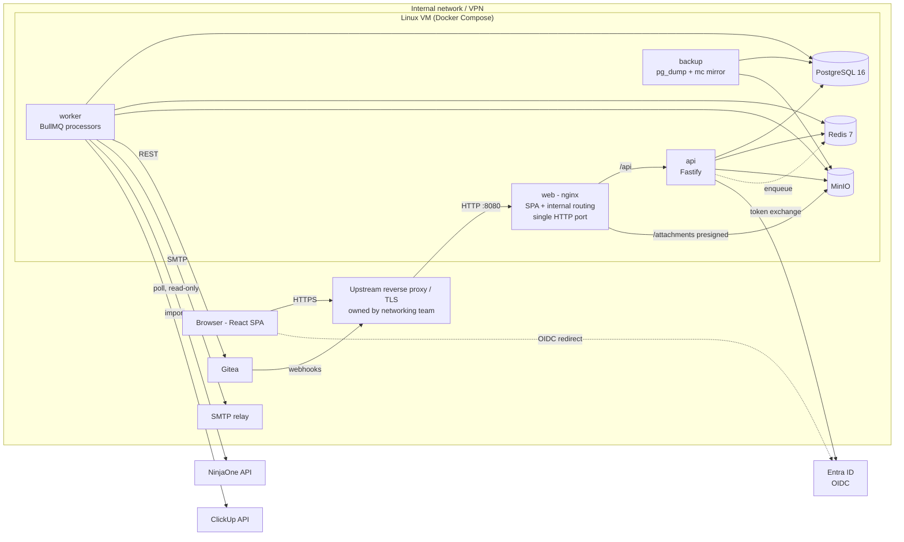
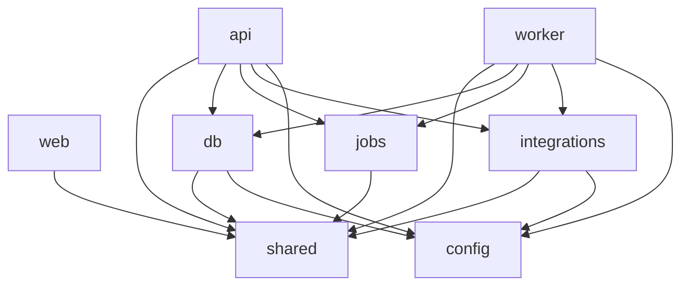

# Architecture

> Status: **Draft for review.** Companion docs: [data-model.md](data-model.md), [permissions.md](permissions.md), [plan.md](plan.md), [../CONTRIBUTING.md](../CONTRIBUTING.md).

## 1. Summary

A single-tenant, self-hosted project-management app replacing ClickUp for ~10 users. It's a **modular monolith**: one API process, one worker process, and one SPA, all sharing a typed core in `packages/*`. There are no microservices, no websockets and no offline mode. The UI polls efficiently and applies the user's own changes optimistically.

### Decisions that change the brief

| Topic | Decision | Reason |
|---|---|---|
| Teams notifications | **Dropped from v1.** The notifier interface still treats channels as plugins, so Teams can be added later. | Owner decision. Avoids the Workflows vs bot choice and its Entra app-consent requirements. |
| Email | **SMTP** through the existing relay (nodemailer). No Graph `Mail.Send`. | No admin-consented Graph permissions wanted. |
| Entra / SSO | OIDC sign-in with delegated `openid profile email` only. Login is restricted with "Assignment required" on the Enterprise app. Groups come from the `groups` claim. | No admin consent needed for mail or directory reads (see §7). |
| NinjaOne | **Read-only, inbound, polled.** Tickets auto-create and update tasks. Nothing is written back. | Owner decision. The host isn't publicly reachable, so it couldn't receive webhooks anyway. |
| Reverse proxy / TLS | **Not in this stack.** The networking team owns certificates and the front proxy. We expose one HTTP port (`web` nginx). | Owner decision. Separation of duties. |
| List ↔ Task link | New feature: a task can be the one-to-one "parent" of a whole List elsewhere, with rollups. | Owner request. ClickUp has no equivalent. |

## 2. System diagram



All outbound traffic to Entra, NinjaOne and ClickUp starts from the VM. The only inbound traffic is from browsers and Gitea, both on the LAN.

## 3. Container layout

| Service | Image | Purpose | Ports (internal) | Volumes |
|---|---|---|---|---|
| `web` | multi-stage → `nginx:1.27-alpine` | **The only published port.** Serves the built Vite SPA (hashed assets are immutable, `index.html` is no-cache, SPA fallback). Proxies `/api/*` → api:3000 and `/attachments/*` → minio:9000 (with the `Host` header preserved so presigned signatures validate). Adds gzip and app security headers (CSP, X-Frame-Options, nosniff). **No TLS.** | 8080 (published, plain HTTP) | – |
| `api` | `node:22-alpine` (multi-stage, pnpm deploy) | Fastify REST API, OpenAPI at `/api/docs`, OIDC, presigned upload URLs | 3000 | – |
| `worker` | same image as api, different entrypoint | BullMQ processors and repeatable jobs | 3001 (health/metrics only) | – |
| `postgres` | `postgres:16` | Primary store, FTS, `pg_trgm` | 5432 | `pg_data` |
| `redis` | `redis:7` (AOF on) | BullMQ queues, rate-limit counters, short-lived caches | 6379 | `redis_data` |
| `minio` | `minio/minio` | Attachments, doc images, import staging | 9000 / 9001 console (dev only) | `minio_data` |
| `backup` (prod) | small alpine + `pg_dump`, `mc`, cron | Nightly dumps, mirroring MinIO to a backup target, retention | – | backup mount |
| `mailpit` (dev) | `axllent/mailpit` | Catches SMTP mail in dev | 8025 UI | – |

**Compose files**
- `compose.yml`: the shared base definitions.
- `compose.dev.yml`: bind-mounts source, runs `tsx watch` / Vite dev server, exposes DB/Redis/MinIO ports, includes mailpit, uses a local "fake OIDC" (`oidc-provider` mock) so devs don't need Entra to work.
- `compose.prod.yml`: pinned image tags from the Gitea registry, no source mounts, resource limits, restart policies, includes the backup service.
- `compose.test.yml`: profile used by CI integration tests (ephemeral Postgres/Redis/MinIO). Testcontainers is used locally when Docker is available.

**Windows 11 dev workflow:** Docker Desktop with the WSL2 backend. **Clone the repo inside the WSL2 filesystem** (`~/code/...`) rather than `C:\`, because bind-mount performance and file watching are far better there. Node and pnpm are installed in WSL, and VS Code connects with the "WSL" remote. `.gitattributes` forces `eol=lf`. All scripts are POSIX `sh` or `pnpm` scripts, with no PowerShell required. `CONTRIBUTING.md` has the step-by-step setup.

**Hosting:** a single Linux VM on internal DNS (e.g. `pm.corp.example`). **The networking team owns TLS, certificates, DNS and the front reverse proxy.** The app stack ships no proxy and no certificates. It exposes **one plain-HTTP port (`web:8080`)** for their proxy to forward to.

**Contract with the networking team** (handed over in ticket `F-14` as `docs/ops/proxy-requirements.md`):

| Requirement | Value |
|---|---|
| Upstream | `http://<vm>:8080`. Everything goes to one upstream: `/`, `/api/*`, `/attachments/*`. |
| Headers to set | `X-Forwarded-For`, `X-Forwarded-Proto: https`, `X-Forwarded-Host`. The original `Host` must be preserved, because presigned attachment URLs are signed for the public host. |
| Public URL | One HTTPS hostname, configured in the app as `PUBLIC_URL`. It's used for the OIDC redirect URI, email links, presigned URLs and the Gitea webhook URL. |
| Request body size | ≥ 250 MB on `/attachments/*` (direct uploads). 10 MB elsewhere. |
| Timeouts | 120 s on `/attachments/*`, 60 s elsewhere. No websockets or SSE are needed. |
| TLS-level headers | HSTS is set by their proxy. The app sets CSP, frame and nosniff headers itself. |
| Reachability | Browsers on the LAN/VPN, and Gitea for `POST /api/integrations/gitea/webhook`. Nothing from the internet. |
| Health check | `GET /api/health` (through web) for their load balancer or monitoring. |

App-side consequences:
- Fastify uses `trustProxy` limited to the proxy's IP (`TRUSTED_PROXY_CIDRS` env), so client IPs (for rate limiting and audit logs) and `https` detection are correct.
- Session cookies are `Secure`, which works because `X-Forwarded-Proto` is trusted.
- In dev there's no TLS proxy. `compose.dev.yml` serves `http://localhost:8080`, and cookies drop `Secure` only when `NODE_ENV=development`.

**Timezone:** the workspace default timezone is `America/Chicago`. Users can override it. The due-date scanner, digests and calendar views all use each user's own timezone.

## 4. Monorepo and module boundaries

```
apps/
  web/          React SPA (Vite, TS, React Router, TanStack Query, Tailwind + shadcn/ui, dnd-kit, TipTap)
  api/          Fastify HTTP server
  worker/       BullMQ processors + schedulers
packages/
  shared/       zod schemas, DTO types, enums, permission policy engine (pure TS, no I/O)
  db/           Drizzle schema, migrations, seed, query helpers incl. ACL filter builders
  integrations/ Integration interface + gitea/, ninjaone/, smtp/, clickup/ clients (no Fastify, no BullMQ)
  jobs/         Queue names, job payload zod schemas, enqueue helpers (used by api + worker)
  config/       env parsing (zod), logger factory (pino), shared tsconfig/eslint presets
tools/
  cli/          `pnpm cli import:clickup …`, `pnpm cli user:create-breakglass`, etc.
docs/
```

### Dependency rules (enforced by `dependency-cruiser` in CI)



- `shared` has **no runtime dependencies** besides zod. It must run in the browser.
- `web` never imports `db`, `integrations` or `config`.
- Inside `apps/api/src/modules/<feature>/`, each feature exposes only `index.ts` (a Fastify plugin plus the service interface). Other modules import a feature's **service**, never its `repo`.

### API feature module shape

```
apps/api/src/modules/tasks/
  index.ts          // fastify plugin: registers routes, exports TaskService type
  routes.ts         // route definitions; schemas imported from @app/shared
  service.ts        // business logic; calls policy + repo; emits domain events
  repo.ts           // Drizzle queries; always takes an AccessContext
  events.ts         // domain event types (TaskCreated, StatusChanged…)
  *.test.ts
```

Planned modules: `auth`, `users`, `groups`, `hierarchy` (spaces, folders, lists), `tasks`, `statuses`, `comments`, `attachments`, `activity`, `search`, `views`, `fields`, `templates`, `list-links`, `automations`, `notifications`, `docs`, `time`, `goals`, `dashboards`, `integrations`, `import`, `admin`, `audit`.

### Domain events → jobs

Services write their changes **and an `outbox` row in the same transaction**. A lightweight dispatcher in the worker reads the outbox (`FOR UPDATE SKIP LOCKED`) and fans events out to queues: automations, notifications, activity and search-index. This guarantees no lost events and no events for rolled-back writes. It stays simple because there's only one Postgres.

## 5. Stack choices

| Choice | Picked | Why |
|---|---|---|
| HTTP framework | **Fastify** (over NestJS) | It's lightweight with fast startup. Its plugin encapsulation maps cleanly to feature modules. Using `fastify-type-provider-zod` with `@fastify/swagger`, the **same zod schemas from `packages/shared`** validate requests and responses, type handlers and generate OpenAPI, with no decorator or class-validator duplication. NestJS's DI and module system is helpful for big teams, but the convention plus lint rules in `CONTRIBUTING.md` give us the same consistency with less ceremony. |
| ORM | **Drizzle** (over Prisma) | Being SQL-first matters here, because every list, search and aggregate query must join the ACL table (`permissions.md` §4). Drizzle composes those filters as typed subqueries and CTEs (recursive CTEs for subtasks and cycle checks). Prisma would push us into `$queryRaw` for exactly the queries that matter most. Drizzle also generates plain SQL migrations (`drizzle-kit generate`) that can be reviewed in PRs, and it has no binary engine to ship in Docker. |
| Validation | zod everywhere | Schemas are shared between client forms (react-hook-form + zodResolver) and the API. |
| Jobs | BullMQ on Redis | Retries, backoff, repeatable jobs, rate limiting per queue and good observability (bull-board in admin UI). |
| Search | Postgres FTS (`tsvector` + GIN) + `pg_trgm` | At 100k tasks we don't need an external engine. The ACL filter applies in the same SQL. |
| Files | MinIO + presigned PUT/GET | The API never streams large bodies. Previews come from PDF/image thumbnails generated by the worker (sharp; pdf → first page via `pdftoppm`). |
| Logging | pino JSON | Includes request ID, user ID and job ID. |
| Metrics | `prom-client` `/metrics` on api and worker | Request latency, queue depth, job failures and integration health. |
| Rich text | TipTap (ProseMirror JSON stored in `jsonb`) | Mentions and task-link nodes are extracted on save into `mentions` and `doc_task_refs` tables for notifications and permission checks. |

## 6. Polling strategy

Realtime isn't required. Every **active** view polls, and inactive tabs stop.

1. **Delta endpoints:** each collection endpoint accepts `?updated_since=<server timestamp cursor>` and returns changed rows plus `tombstones` (IDs deleted, archived or moved out of scope **or no longer visible to the caller**). Every mutable table has `updated_at` (set by trigger) and an index `(scope_col, updated_at)`. Deletions and moves write to a `change_log` table, `(id, entity, entity_id, scope_id, changed_at)`, which is kept for 7 days and drives tombstones.
2. **Cursor:** the server returns `X-Sync-Cursor` = `now() - 2s` (a skew margin). The client stores it per query key.
3. **ETag / 304:** single-resource GETs (task detail, doc, view config) return weak ETags built from `updated_at` + the caller's permission-version. `If-None-Match` → `304`, with no body.
4. **Cadence:** TanStack Query `refetchInterval` is 15s for the focused view and task detail, 30s for sidebar, inbox count and dashboards, and stops when hidden (`refetchIntervalInBackground: false`). It refetches immediately on window focus.
5. **Merge:** the client merges deltas into the cached pages. If the server says `resync: true` (the cursor is older than `change_log` retention, or the caller's permission-version changed), the client refetches fully.
6. **Optimistic UI:** mutations update the cache immediately (`onMutate`) and roll back on error. The server response replaces the optimistic row.
7. **Cost:** with 10 users and a few open views each, that's under 5 req/s. Every delta query is index-only on `(list_id, updated_at)` plus the ACL join.

## 7. Authentication

- **OIDC authorization code + PKCE** with Entra ID using `openid-client`. The API acts as a confidential client and does the code exchange server-side. The client secret is managed in the credentials GUI (§9.0), and env values only seed it on first boot. The browser only ever holds an **HTTP-only, Secure, SameSite=Lax session cookie**.
- **Entra setup (no admin-consented Graph permissions):**
  - App registration with redirect URI `https://pm.corp.example/api/auth/callback` and delegated scopes `openid profile email`. User consent is enough, or an admin can grant it once tenant-wide. These scopes don't expose mailboxes or the directory.
  - Enterprise app → **Assignment required = Yes**, with the allowed security group(s) assigned. Unassigned users are rejected by Entra before they reach us.
  - Token configuration → **groups claim** (security groups, "groups assigned to the application" to avoid the 200-group overage). On every login we upsert the user's `group_members` rows for Entra-linked groups. Membership is therefore as fresh as the user's last login. A background sync would need `GroupMember.Read.All`, which is optional and off by default.
- **User mapping:** match on `oid` (stable), falling back to email/UPN for first login and for ClickUp import matches. A user is auto-provisioned as **Member** on first login (configurable default role).
- **Sessions:** a `sessions` table (opaque ID, hashed in DB), 12h sliding with an 8-day maximum. It's revoked on logout and when an admin disables the user.
- **CSRF:** SameSite=Lax cookie **plus** a double-submit token (`X-CSRF-Token` header on all non-GET requests). Fastify `@fastify/csrf-protection`.
- **Rate limiting:** `@fastify/rate-limit` backed by Redis: 10/min/IP on `/auth/*`, 300/min/user elsewhere.
- **Break-glass:** if `BREAKGLASS_ENABLED=true`, a local `admin` login at `/auth/local` is enabled, using an argon2id password and optional TOTP. Every use is audit-logged and shows a banner. It's created through `pnpm cli user:create-breakglass`.

## 8. Job queue design

| Queue | Producers | Jobs | Concurrency | Notes |
|---|---|---|---|---|
| `events` | outbox dispatcher | fan-out of domain events | 4 | Routes each event to the queues below |
| `automations` | events, scheduler | `evaluate-rule`, `run-action` | 4 | Idempotent via `jobId = ruleId:eventId` |
| `notifications` | events, automations | `fanout`, `send-email`, `digest` | 4 | Permission check **at send time** |
| `integrations` | webhooks, UI, automations | `gitea.*`, `webhook.deliver` | 2 per integration (BullMQ group key) | Retries with exponential backoff and jitter |
| `scheduled` | repeatable | `due-date-scan` (1 min), `ninja.poll` (delta board, default 2 min), `ninja.reconcile` (nightly, plus at startup when stale), `snooze-wake`, `change-log-prune`, `session-prune` | 1 | `due-date-scan` emits `DueDateArrived/Passed` events once per task per transition |
| `import` | admin UI / CLI | `clickup.run` → `clickup.page` | 1 | Throttled to the ClickUp rate limit. Resumable checkpoints. |
| `files` | attachments | `thumbnail`, `virus-scan` (optional ClamAV) | 2 | |
| `search` | events | `reindex-entity` | 2 | Updates `search_vector` columns that triggers can't compute (e.g. TipTap JSON → text) |

**General rules**
- Every job payload is a zod schema in `packages/jobs`. Processors parse it before doing anything.
- **Idempotency:** a deterministic `jobId` where possible. Side effects are guarded by a unique key in Postgres (`automation_runs (rule_id, event_id)`, `notifications (dedupe_key)`, `webhook_deliveries (subscription_id, event_id)`).
- **Retries:** 5 attempts, exponential backoff of 2s → ~1min with jitter. After that the job goes to the **failed** set, is visible in Admin → Jobs, and can be retried manually.
- **Loop protection for automations:** each event carries `causation = {rootEventId, depth, ruleIds[]}`. Actions performed by an automation emit events with `depth+1` and the rule appended. Evaluation is skipped if `depth > 5` or if the rule already appears in the chain. A per-rule circuit breaker allows at most 100 runs per minute and then auto-disables the rule with an admin notification.
- **Logging:** each run writes `automation_runs`, `integration_sync_logs` or `import_runs` rows (status, duration, error, payload hash).

## 9. Integrations

### 9.0 Credentials and settings GUI (all external services)

**Every external credential is entered, tested and rotated in Admin → Integrations & Credentials.** Nobody has to edit `.env` or redeploy to change one.

| Service | Fields in the GUI | Test button checks |
|---|---|---|
| Microsoft Entra (SSO) | tenant ID, client ID, **client secret** (+ expiry date), required group(s), default role, groups-claim on/off | OIDC discovery reachable. Client credentials accepted by the token endpoint. |
| SMTP | host, port, TLS mode, username, **password**, from address/name | Connect + AUTH, then send a test email to the admin |
| Gitea | base URL, **API token**, **webhook secret** (generate button), repos | `GET /api/v1/user`, list repos. Shows the webhook URL to paste into Gitea |
| NinjaOne | region, client ID, **client secret**, delta board, source boards, intervals | Token fetch with `monitoring` scope, list boards, run the delta board (page 1) |
| ClickUp (import) | **API token**, team/workspace ID | `GET /team`, shows the rate-limit headers seen |
| Outbound webhooks | URL, **signing secret** per subscription | Sends a signed test event |

**Rules**
- Secrets are **write-only**. The API never returns them, and the UI shows `••••` plus "last changed by X on date". They're encrypted at rest in `integration_secrets` (AES-256-GCM).
- Every change is written to `audit_log` (the field name only, never the value). Only Owners and Admins can see the page.
- **Expiry tracking:** secrets with a known expiry (Entra client secrets last at most 24 months, and some API tokens expire too) store `expires_at`. Admins get in-app and email notices 30, 7 and 1 days before expiry, and the health indicator turns amber.
- Changes take effect without a restart: api and worker read config through a cached `getIntegrationConfig()` that's invalidated over Redis pub/sub on save.

**What stays in env (bootstrap only):** `DATABASE_URL`, `REDIS_URL`, the MinIO root credentials (internal services, generated at install), **`APP_ENCRYPTION_KEY`** (the master key, which can't sit in the DB it protects), `SESSION_SECRET`, `PUBLIC_URL` and `TRUSTED_PROXY_CIDRS`. TLS and DNS credentials belong to the networking team and never touch this stack. If Entra values are present in env, they **seed** the GUI on first boot. After that, the GUI values win. If SSO is misconfigured, the break-glass admin (§7) is how you get back in to fix it.

### 9.1 Integration interface

Every integration implements:

```ts
interface Integration<Config> {
  key: 'gitea' | 'ninjaone' | 'smtp' | 'clickup' | 'outbound-webhook';
  configSchema: ZodType<Config>;          // rendered as admin settings form
  secretFields: (keyof Config)[];         // encrypted at rest (AES-256-GCM, key from APP_ENCRYPTION_KEY)
  healthCheck(ctx): Promise<HealthResult>;// shown as green/amber/red in Admin → Integrations
  jobs: Record<string, JobProcessor>;     // registered by worker
  routes?: FastifyPluginAsync;            // e.g. inbound webhook endpoint
}
```

Config lives in `integrations` (jsonb), secrets in `integration_secrets` (encrypted). Each sync or delivery writes `integration_sync_logs`. Health is the last successful run plus the error rate over the last hour. The `configSchema` and `secretFields` generate the settings form described in §9.0, so a new integration gets its GUI without any extra UI code. `entra` is registered as an integration too, but only for config and health.

### 9.1a SMTP (email)
nodemailer to the internal relay. Templates use MJML → HTML plus a plain-text alternative. Emails are generated **per recipient after a permission check** and never include content the recipient can't view (see permissions.md §6).

### 9.2 Gitea
- **Inbound:** `POST /api/integrations/gitea/webhook`. Verifies `X-Gitea-Signature` (HMAC-SHA256 of the raw body, compared in constant time) and rejects anything unsigned. Handles `push`, `create` (branch), `pull_request`. It parses task keys like `PROJ-123` (the `tasks.key` with a per-Space prefix) and `#<shortid>` from branch names, commit messages and PR titles/bodies, then upserts `gitea_links`. Shown on the task's "Development" panel.
- **PR merged → status:** a per-List rule (built on the automation engine trigger `external_event: gitea.pr_merged`).
- **Outbound:** "Create branch" / "Create issue" from a task using the Gitea API token (`write:repository`, `write:issue`). The branch name defaults to `feat/PROJ-123-slug`.

### 9.3 NinjaOne (read-only, polled)

**API facts checked October 2026** (sources: NinjaOne Public API reference and community clients; see links at the end):
- Base host is regional (`app.ninjarmm.com`, `eu.ninjarmm.com`, `ca.ninjarmm.com`, `oc.ninjarmm.com`, `us2.ninjarmm.com`). OAuth2 **client credentials** comes from an "API Services (machine-to-machine)" app.
- **Scope:** `monitoring` (read) is enough for our read-only use, so we **don't** request `management` or `control`.
- Ticketing endpoints we use:
  - `GET /v2/ticketing/trigger/boards`: list boards (note the plural; the singular path 404s)
  - `POST /v2/ticketing/trigger/board/{boardId}/run`: tickets for a board. Body includes `filters`, `sortBy`, `pageSize`, `lastCursorId`, `searchCriteria`, `includeColumns`. The response includes `lastCursorId` for paging.
  - `GET /v2/ticketing/ticket/{ticketId}`: ticket detail
  - `GET /v2/ticketing/ticket/{ticketId}/log-entry`: comments and activity (log entries, filtered by type)
  - `GET /v2/ticketing/statuses`, `GET /v2/ticketing/attributes`, `GET /v2/ticketing/ticket-form`: used for building mapping rules in the admin UI

**Design: a "delta board" plus reconcile**

We maintain a NinjaOne board, the **delta board**, whose condition is "updated in the last 24h". It does the incremental filtering for us, so we keep no high-water mark, need no `sortBy` on last-updated, and use no overlap window.

1. **`ninja.poll`** (repeatable, default every 2 min): run `POST /v2/ticketing/trigger/board/{deltaBoardId}/run` and page through **the whole board**. A 24-hour window should only be tens of tickets. Upsert each ticket into `ninja_tickets` (raw snapshot plus a content hash). **Only tickets whose hash changed** go on to steps 3–5.
2. **`ninja.reconcile`**: run every board listed in `config.sourceBoardIds` (the full source boards) and process each ticket exactly as in step 1. It runs:
   - **at worker startup** when `last_successful_poll_at` is older than `reconcileIfStaleHours` (default 20h), because outages longer than 24h would otherwise lose changes that fell off the delta board.
   - **on a schedule** (`reconcileCron`, default nightly 02:00) as a safety net.
   - **on demand** from Admin → Integrations, and for the **initial backfill** at first enable and during the ClickUp cutover.
   While a reconcile is running, `ninja.poll` is skipped (BullMQ group lock), so the two never race.
3. For new tickets that match a mapping rule (`ninja_board_mappings`: org, status, form and priority filters → target List), **create a task** with key fields mapped. For changed tickets, apply status mapping and field updates to the linked task.
4. For changed tickets, fetch `log-entry` and append new public comments as task comments authored by a "NinjaOne" system user, deduped by log entry ID.
5. Emit `external_event: ninjaone.ticket_created / ticket_updated` so automations can react.
6. **A ticket leaving the delta board means nothing.** It isn't treated as closed or deleted. Only an actual status change in the ticket snapshot moves the linked task.
7. **Never write to NinjaOne.** The client class exposes only GET methods plus the board-run POST, which is a read and is allow-listed explicitly.

**Config** (`integrations.config` for `ninjaone`, zod `NinjaOneConfig`):

```ts
{
  region: 'us' | 'us2' | 'eu' | 'ca' | 'oc',   // default 'us' (app.ninjarmm.com); confirm in I-NJ-01 from the tenant login URL
  clientId: string,                 // clientSecret lives in integration_secrets
  deltaBoardId: number,             // "updated in last 24h" board, polled every pollIntervalSec
  sourceBoardIds: number[],         // full boards used by reconcile and backfill
  pollIntervalSec: number,          // default 120
  reconcileCron: string,            // default '0 2 * * *'
  reconcileIfStaleHours: number,    // default 20 (must stay < 24, the delta board's window)
}
```

**Board coverage rule:** the delta board's filters must be a **superset** of every org, status and form that a mapping rule uses. Otherwise those tickets never sync. The admin UI warns when a mapping references a filter value that hasn't appeared on the delta board in the last 7 days. The `I-NJ-01` spike checks this coverage against our tenant.

**Gaps and risks to confirm against our tenant (ticket `I-NJ-01` spike)**
- **No documented `updated_since` parameter.** The delta board makes this irrelevant.
- The type of the `lastCursorId` cursor is inconsistent between sources (integer vs string). It only matters for paging within one board run, so we treat it as opaque.
- The delta board must exist in NinjaOne, and its window must really be 24h. If someone edits the board, the reconcile cadence has to change with it.
- There's **no ticket webhook we can receive** (and our host is internal anyway), so we rely on polling, which is acceptable.
- Ticket attachments aren't exposed under the ticket resource, so **attachments aren't synced in v1**. We link to the ticket in NinjaOne instead.
- Reading log entries is per ticket (N+1). We only fetch them for tickets whose hash changed.
- Rate limits aren't clearly documented. The client uses token-bucket throttling (default 5 req/s) and backs off on `429`.
- Whether the `monitoring` scope alone allows ticketing reads must be verified. If it doesn't, we request `management` but keep the client's write-free allow-list.

### 9.4 Outbound webhooks (generic)
Admins define subscriptions (URL, secret, event types, **scope**: Space/Folder/List). The payload is signed with `X-Signature: sha256=…`. Payloads are **filtered against a configured "acting principal"** (a service user with its own ACL), so a webhook never leaks tasks outside what that principal can view. Deliveries are logged and retried.

### 9.5 ClickUp importer
See [plan.md](plan.md) phase 4 and data-model `import_runs` / `external_ids`. Key facts:
- **Rate limit: our workspace is on the Business plan, so it gets 100 req/min per token.** (Business Plus gets 1,000 and Enterprise 10,000.) The importer budgets about 90 req/min to leave headroom for anyone still using ClickUp. It reads `X-RateLimit-Remaining` / `X-RateLimit-Reset` and throttles adaptively, and it backs off on 429.
- v2 is used for the hierarchy, tasks, comments, time and custom fields. v3 is used for Docs.
- **Time estimate (<10k tasks at 90 rpm):**
  - Task list pages (100 per page, with subtasks, checklists and custom field values inline): about 100 calls.
  - Comments: one call per task that has comments, plus one per threaded reply set.
  - Time entries, docs and views: a few hundred calls.
  - Attachment downloads come from ClickUp's file host and aren't counted against the API limit.
  - **Total: a full import takes about 2–3 hours.** That's fine for an overnight trial import.
- **Delta** mode uses `date_updated_gt`, so only changed tasks pay the per-task comment call. The final cutover delta takes minutes.
- **Checkpointing:** `import_runs.cursor` (jsonb) records the last completed stage, space, list and page. A crash resumes from the cursor. All writes are upserts keyed by `external_ids (source, entity, external_id)`.

## 10. Observability and operations

- **Health:** `GET /health` (liveness) and `/health/ready` (DB, Redis, MinIO reachable, migrations current) on api and worker. Compose health checks use these, and `/api/health` is exposed through `web` for the networking team's proxy.
- **Logs:** pino JSON to stdout, collected by Docker. Optionally ship them to an existing Loki or Graylog. Every log line includes `reqId`, `userId` and `jobId`.
- **Metrics:** `/metrics` (Prometheus format): HTTP latency histograms, queue depth and failures, integration health gauges, and import progress.
- **Backups:** nightly `pg_dump -Fc` (14 daily + 8 weekly retention) and `mc mirror` of MinIO to a backup target (NAS/S3). Both are verified weekly by an automated restore into a scratch container (`backup-verify` job). The restore procedure is documented in `docs/ops/restore.md` (ticket `H-02`).
- **Migrations:** `drizzle-kit` SQL migrations run by a one-shot `migrate` service before `api` and `worker` start (compose `depends_on: condition: service_completed_successfully`).
- **Security:** zod input validation on client and server, CSP/X-Frame-Options/nosniff from `web` (nginx) and `@fastify/helmet` (HSTS from the upstream proxy), presigned URLs that expire in 5 minutes, `Content-Disposition: attachment` for non-previewable uploads, and AES-256-GCM encryption of integration secrets with key rotation support (`key_id` column).

## 11. Sources (NinjaOne and ClickUp API research)

- [NinjaOne Public API reference: List of tickets for board](https://app.ninjarmm.com/apidocs-beta/core-resources/operations/getTicketsByBoard)
- [NinjaOne: Filter tickets with the Public API](https://www.ninjaone.com/docs/application-programming-interface-api/ticket-filtering-api/)
- [NinjaOne: OAuth token configuration](https://www.ninjaone.com/docs/application-programming-interface-api/oauth-token-configuration/)
- [WYRE-AI/ninjaone-mcp PR #98 (endpoints checked against OpenAPI 2.0.9)](https://github.com/WYRE-AI/ninjaone-mcp/pull/98)
- [node-ninjaone issue #92 (boards path)](https://github.com/WYRE-AI/node-ninjaone/issues/92)
- [n8n-nodes-ninjaone README (client-credentials write limits, log-entry path)](https://cdn.jsdelivr.net/npm/@ev1lc0rp/n8n-nodes-ninjaone@0.6.1/README.md)
- [ClickUp API rate limits](https://developer.clickup.com/docs/rate-limits)
