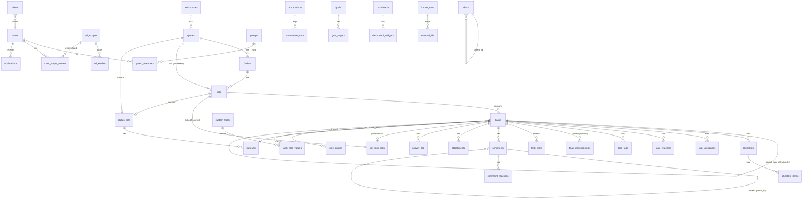

# Data Model

> Status: **Draft for review.** PostgreSQL 16, Drizzle ORM, SQL migrations. See [permissions.md](permissions.md) for how the ACL tables are used.

## 0. Conventions

- **IDs:** `uuid` v7 (time-ordered, generated in app) for every primary key, named `id`. Foreign keys are named `<entity>_id`.
- **Human keys:** tasks get `key` = `<space.key_prefix>-<seq>` (e.g. `OPS-142`) and a `short_id` (first 8 chars of a base32 hash). Gitea linking parses both.
- **Timestamps:** `created_at`, `updated_at timestamptz not null default now()`. A trigger maintains `updated_at`. Soft delete is `archived_at` (archived but restorable) and `deleted_at` (in trash, purged after 30 days).
- **Workspace:** single-tenant, but `workspace_id` is kept on top-level objects. That costs nothing and makes future multi-workspace support, as well as ClickUp import from multiple teams, cheap.
- **Rich text:** TipTap/ProseMirror JSON in `jsonb` plus a derived `text` column for search.
- **Enums:** Postgres enums for stable sets (`permission_level`, `status_group`, `workspace_role`). `text` + zod for sets that change often.
- **Securable objects** (`spaces`, `folders`, `lists`, `tasks`, `docs`) all carry `acl_scope_id` (denormalized; see §3).

## 1. ERD (core)

## 2. Identity

| Table | Columns | Notes |
|---|---|---|
| `users` | id, email (citext unique), display_name, avatar_url, entra_oid (unique null), upn, **role** `workspace_role` (owner/admin/member/guest), is_active, is_system (bool, e.g. "NinjaOne", "Automation"), is_breakglass, password_hash (null except break-glass), totp_secret_enc, timezone (null → workspace default `America/Chicago`), locale, theme, last_login_at | `role` is the workspace role. System users can't log in. |
| `groups` | id, name, description, source (`local`/`entra`), entra_group_id (unique null), is_system (e.g. `All Members`) | `All Members` is a system group that contains every non-guest user and is used for default grants. |
| `group_members` | group_id, user_id, source (`local`/`entra`), PK(group_id,user_id) | Entra-sourced rows are replaced on each login from the `groups` claim. |
| `sessions` | id (hash of token), user_id, created_at, last_seen_at, expires_at, ip, user_agent, csrf_secret | |
| `api_tokens` | id, user_id, name, token_hash, scopes text[], last_used_at, expires_at | For CLI and personal automation (optional). |

## 3. Hierarchy and ACL

| Table | Columns | Notes |
|---|---|---|
| `workspaces` | id, name, settings jsonb | One row. |
| `spaces` | id, workspace_id, name, key_prefix (unique, e.g. `OPS`), color, icon, status_set_id, task_seq (int), position, **acl_scope_id**, archived_at | `task_seq` is incremented with `UPDATE … RETURNING` when a task is created. |
| `folders` | id, space_id, name, position, **acl_scope_id**, archived_at | Folders are optional. |
| `lists` | id, space_id, folder_id (null), name, description jsonb, status_set_id (null → inherit space), default_assignee_id, position, **acl_scope_id**, archived_at | |
| **`acl_scopes`** | id, object_type (`workspace`/`space`/`folder`/`list`/`task`/`doc`), object_id, **parent_scope_id** (null when inheritance is broken), **mode** (`additive`/`override`), version int | Exists only for objects that have their own grants. See permissions.md §2. |
| **`acl_entries`** | id, scope_id, principal_type (`user`/`group`), principal_id, **level** `permission_level` (view/comment/edit/full), granted_by, granted_at, UNIQUE(scope_id, principal_type, principal_id) | |
| **`user_scope_access`** | user_id, scope_id, level, PK(user_id, scope_id) | **Materialized** effective access, rebuilt by `acl.recompute()` inside the same transaction as any ACL, group or move change. Index (scope_id, user_id). |
| `permission_versions` | user_id PK, version bigint | Bumped whenever a user's `user_scope_access` changes. Included in ETags and delta cursors so clients resync. |

`acl_scope_id` on every securable object = the ID of its **own** scope if it has one, else its parent's `acl_scope_id`. The workspace always has a root scope (`mode=override`, with the default grant `All Members → edit`).

## 4. Tasks

| Table | Columns | Notes |
|---|---|---|
| `status_sets` | id, name, owner_type (`space`/`list`), owner_id | |
| `statuses` | id, status_set_id, name, color, **group** `status_group` (open/active/done/closed), position | Exactly one default `open` status per set (partial unique index). |
| `tasks` | id, workspace_id, list_id, **parent_task_id** (null), **path** ltree (ancestor chain for subtasks), key, short_id, seq, name, description jsonb, description_text, status_id, priority smallint (null,1–4), start_at, due_at, due_has_time bool, time_estimate_min int, points numeric, position (fractional index text), **acl_scope_id**, created_by, archived_at, deleted_at, completed_at, **search_vector** tsvector, source (`app`/`clickup`/`ninjaone`) | A subtask's `list_id` equals its root's. `completed_at` is set when the status group becomes done or closed. |
| `task_assignees` | task_id, user_id, assigned_at, PK | |
| `task_watchers` | task_id, user_id, PK | Assignees and commenters are auto-added. |
| `tags` | id, space_id, name, color, UNIQUE(space_id, lower(name)) | |
| `task_tags` | task_id, tag_id, PK | |
| `checklists` | id, task_id, name, position | |
| `checklist_items` | id, checklist_id, parent_item_id (nested), name, assignee_id, resolved bool, position | |
| `task_dependencies` | task_id (waiting), depends_on_task_id (blocking), type (`blocks`), PK | Cycle check in service. |
| `task_links` | task_a_id, task_b_id (ordered a<b), created_by, PK | Undirected "linked tasks". |
| **`list_task_links`** | id, **task_id UNIQUE**, **list_id UNIQUE**, created_by, created_at | **List ↔ Task parent link** (1:1). Deleting either side cascades. Cycle check: the task's own List (and every List linked beneath it, recursively) cannot be the linked List. |
| `comments` | id, task_id (null), doc_id (null), parent_id (thread), author_id, body jsonb, body_text, **assigned_to_id** (null), assignee_resolved_at, edited_at, deleted_at, search_vector, source_external (e.g. Ninja log entry id) | "Assign comment" uses `assigned_to_id`. CHECK that exactly one of task_id/doc_id is set. |
| `comment_reactions` | comment_id, user_id, emoji, PK | |
| `mentions` | id, source_type (`comment`/`doc`/`task_description`), source_id, mentioned_user_id, created_at | Extracted on save. Drives notifications. |
| `attachments` | id, task_id (null), comment_id (null), doc_id (null), uploader_id, filename, content_type, size_bytes, storage_key, thumbnail_key, sha256, created_at, deleted_at | Inherits ACL from its parent object. |
| `activity_log` | id (bigserial), entity_type, entity_id, task_id (null, for fast per-task feed), actor_id, actor_kind (`user`/`automation`/`integration`/`import`), action, diff jsonb, causation jsonb, created_at | Per-task history. Partition by month if it grows. |
| `audit_log` | id, actor_id, action, target_type, target_id, before jsonb, after jsonb, ip, created_at | Security-relevant actions: **all ACL changes**, role changes, logins, break-glass use, integration config, exports. Append-only (no UPDATE/DELETE grant for the app role). |
| `change_log` | id bigserial, entity, entity_id, scope_container_id (list/space), op (`delete`/`archive`/`move_out`), changed_at | Tombstones for delta polling. Kept 7 days. |
| `outbox` | id bigserial, event_type, payload jsonb, causation jsonb, created_at, dispatched_at | Transactional outbox (architecture §4). |

**Indexes (key ones)**
- `tasks (list_id, archived_at, position)`, `tasks (list_id, updated_at)`, `tasks (acl_scope_id)`, `tasks USING gist (path)`, `tasks (parent_task_id)`, `tasks (due_at) WHERE archived_at IS NULL AND completed_at IS NULL`, `tasks USING gin (search_vector)`, `tasks USING gin (name gin_trgm_ops)`, `tasks (key) UNIQUE`, `tasks (short_id) UNIQUE`.
- `task_assignees (user_id, task_id)` for My Work. `comments (task_id, created_at)`. `activity_log (task_id, created_at desc)`.

## 5. Custom fields

| Table | Columns | Notes |
|---|---|---|
| `custom_fields` | id, workspace_id, name, **type** (text, number, currency, dropdown, labels, date, checkbox, user, url, email, phone, rating, progress, relationship, formula), config jsonb (options, currency code, precision, rating max, relationship target list, formula expr), **scope_type** (`space`/`folder`/`list`), scope_id, required bool, position, archived_at | A field applies to every task beneath its scope. |
| `task_field_values` | task_id, field_id, value jsonb, **value_text**, **value_num** numeric, **value_date** timestamptz, **value_bool**, updated_at, updated_by, PK(task_id, field_id) | The typed shadow columns are indexed for filtering and sorting: (field_id, value_num), (field_id, value_date), (field_id, value_text). |
| `task_field_value_refs` | task_id, field_id, ref_type (`user`/`option`/`task`), ref_id | Multi-value types (labels, users, relationship) use this for indexed `IN` filters. |

Formula fields (stretch goal) are evaluated server-side with a safe expression evaluator (`expr-eval`-like, with no `eval`) and never stored.

## 6. Views

| Table | Columns | Notes |
|---|---|---|
| `views` | id, workspace_id, **scope_type** (`space`/`folder`/`list`/`everything`/`my_work`), scope_id, **type** (`list`/`board`/`calendar`/`gantt`/`table`), name, **visibility** (`personal`/`shared`), owner_id, **config** jsonb (zod `ViewConfig`: filters AST, group_by, sort[], visible_columns[], column widths, show_subtasks, show_closed, date_field for calendar and gantt), position, is_default | Personal views are visible only to their owner. Shared views need Edit on the scope to create. |
| `view_user_state` | view_id, user_id, collapsed_groups jsonb, last_opened_at | Per-user UI state for a shared view. |

The filter AST (`packages/shared/src/filters.ts`) compiles to Drizzle SQL **after** the ACL join is applied (permissions.md §4).

## 7. Templates

| Table | Columns |
|---|---|
| `templates` | id, kind (`task`/`list`), name, description, payload jsonb (serialized task tree or list with tasks, checklists, field values, relative dates), created_by, scope_type, scope_id, visibility |

## 8. Automations

| Table | Columns | Notes |
|---|---|---|
| `automations` | id, workspace_id, name, scope_type (`space`/`folder`/`list`), scope_id, **trigger** jsonb (zod `Trigger`: type ∈ task_created, status_changed, assignee_changed, due_date_arrived, due_date_passed, field_changed, comment_added, linked_list_completed, external_event{source: gitea/ninjaone, event}), **conditions** jsonb (filter AST), **actions** jsonb[] (zod `Action`: set_status, set_assignees, set_field, create_subtask, apply_template, notify{channels: in_app/email, recipients}, call_webhook{subscription_id}), enabled, run_as_user_id (service principal), created_by, disabled_reason, updated_at | `run_as_user_id` determines the ACLs that apply to actions and webhook payloads. |
| `automation_runs` | id, automation_id, event_id, task_id, status (`skipped`/`succeeded`/`failed`/`loop_blocked`), causation jsonb, actions_result jsonb, error, started_at, finished_at, UNIQUE(automation_id, event_id) | The unique constraint gives idempotency. |

## 9. Notifications

| Table | Columns | Notes |
|---|---|---|
| `notifications` | id, user_id, event_type, entity_type, entity_id, task_id, actor_id, payload jsonb (minimal; rendered at read time with an ACL check), **dedupe_key** UNIQUE, read_at, cleared_at, **snoozed_until**, created_at | Inbox. Index (user_id, cleared_at, created_at desc). |
| `notification_preferences` | user_id, event_type (assigned, mentioned, comment_on_watched, status_changed, due_soon, overdue, assigned_comment, automation), channel (`in_app`/`email`), enabled, digest (`instant`/`hourly`/`daily`), PK(user_id,event_type,channel) | Workspace defaults live in `workspaces.settings`. Rows are overrides only. |
| `email_outbox` | id, user_id, notification_ids uuid[], subject, status, attempts, last_error, sent_at | Logs SMTP sends. Supports digests. |

## 10. Integrations

| Table | Columns | Notes |
|---|---|---|
| `integrations` | id, key (`entra`/`gitea`/`ninjaone`/`smtp`/`clickup`), enabled, config jsonb, health (`ok`/`degraded`/`down`/`unknown`), health_detail, last_success_at, updated_by | One row per integration. |
| `integration_secrets` | integration_id, name, ciphertext bytea, iv, auth_tag, key_id, **expires_at** (null), updated_by, updated_at, PK(integration_id,name) | AES-256-GCM. The key comes from env. Write-only through the API. `expires_at` drives the expiry reminders (architecture §9.0). |
| `integration_sync_logs` | id bigserial, integration_id, job_name, status, started_at, finished_at, stats jsonb, error, attempt | |
| `gitea_repos` | id, owner, name, url, space_id (default target), webhook_secret_ref | |
| `gitea_links` | id, task_id, repo_id, kind (`commit`/`branch`/`pr`), ref (sha/branch/PR number), title, url, author, state (open/merged/closed), occurred_at, UNIQUE(task_id, repo_id, kind, ref) | |
| `ninja_board_mappings` | id, board_id, board_name, target_list_id, filters jsonb (org IDs, statuses, priorities), status_map jsonb (ninja status → our status_id), field_map jsonb, sync_comments bool, enabled | Admin-configured mapping rules. |
| `ninja_tickets` | ticket_id PK, board_id, task_id (unique null), snapshot jsonb, snapshot_hash, ninja_updated_at, last_polled_at, last_log_entry_id | Read-only mirror. Its `task_id` is the 1:1 link to the task. |
| `ninja_sync_state` | id PK (single row), last_successful_poll_at, last_reconcile_at, last_reconcile_status, last_reconcile_stats jsonb | Drives the "reconcile at startup if stale" check. Board IDs and cadences live in `integrations.config` (architecture §9.3). |
| `webhook_subscriptions` | id, name, url, secret_ref, event_types text[], scope_type, scope_id, acting_user_id, enabled | Generic outbound webhooks. |
| `webhook_deliveries` | id, subscription_id, event_id, status, http_status, attempts, next_attempt_at, response_excerpt, UNIQUE(subscription_id, event_id) | |

## 11. Docs, time, goals, dashboards

| Table | Columns | Notes |
|---|---|---|
| `docs` | id, workspace_id, parent_doc_id (nesting), container_type (`space`/`folder`/`list`), container_id, title, content jsonb, content_text, **acl_scope_id**, position, created_by, updated_by, archived_at, search_vector | |
| `doc_task_refs` | doc_id, task_id, PK | Embedded task links. Rendering re-checks access. |
| `doc_revisions` | id, doc_id, content jsonb, author_id, created_at | Snapshots throttled to one per 5 minutes. |
| `time_entries` | id, user_id, task_id (null), description, started_at, ended_at (null = running), duration_sec (computed when stopped), billable bool, source (`timer`/`manual`/`clickup`), created_at | A partial unique index enforces **one running timer per user**: `(user_id) WHERE ended_at IS NULL`. Index (user_id, started_at), (task_id). |
| `goals` | id, workspace_id, name, description, owner_id, due_at, folder (text grouping), visibility (`workspace`/`private`), acl_scope_id | |
| `goal_targets` | id, goal_id, name, kind (`number`/`boolean`/`task_completion`/`currency`), start_value, target_value, current_value, unit, task_filter jsonb (for task_completion: list IDs or task IDs) | Progress is computed. Task-completion targets count only tasks visible to the viewer. |
| `dashboards` | id, workspace_id, name, owner_id, visibility (`personal`/`shared`) | |
| `dashboard_widgets` | id, dashboard_id, type (`status_counts`/`assignee_counts`/`workload`/`time_tracked`/`burndown`/`task_list`/`goal`), config jsonb (scope + filter AST), layout jsonb (x,y,w,h) | Every widget query goes through the ACL filter. |

## 12. Import mapping (ClickUp)

| Table | Columns | Notes |
|---|---|---|
| `import_runs` | id, source (`clickup`), mode (`dry_run`/`full`/`delta`), status (`queued`/`running`/`paused`/`succeeded`/`failed`), started_by, started_at, finished_at, **cursor** jsonb (resume checkpoint), **since** timestamptz (for delta), stats jsonb (counts per entity: seen/created/updated/skipped), report jsonb (warnings, losses) | |
| **`external_ids`** | source, entity (`space`/`folder`/`list`/`task`/`comment`/`attachment`/`field`/`status`/`tag`/`doc`/`time_entry`/`view`/`user`), external_id, internal_id, import_run_id (last touched), checksum, PK(source, entity, external_id), UNIQUE(source, entity, internal_id) | Makes re-runs and deltas idempotent: we look up and then upsert. |
| `import_user_mappings` | clickup_user_id PK, clickup_email, clickup_name, user_id (null until resolved), resolution (`auto_email`/`manual`/`placeholder`/`skip`) | The review step lists unmatched users. |
| `import_issues` | id, import_run_id, severity (`info`/`warn`/`error`), entity, external_id, message | Feeds the dry-run report. |

## 13. Search

- `search_vector` columns on `tasks` (name A, key A, description_text B), `comments` (body_text), `docs` (title A, content_text B). They're maintained by triggers for plain columns and by the `search.reindex-entity` job for JSON-derived text.
- A unified search endpoint queries `UNION ALL` over the three tables, each **joined to `user_scope_access`** before ranking (`ts_rank_cd` plus a trigram similarity boost on names), and paginates with keyset on (rank, id).
