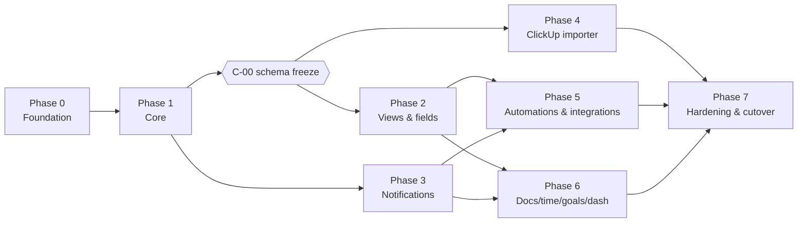

# Implementation Plan

> Status: **Draft for review.** Ticket IDs match the references in [architecture.md](architecture.md) and [permissions.md](permissions.md).
> **Size:** S ≤ 2 days, M ≤ 1 week, L ≤ 2 weeks (for one dev). **Deps** lists the tickets that must be merged first. Tickets that don't depend on each other can run in parallel.

## Changes from the brief's phasing

1. **Teams removed** (owner decision). Phase 3 covers in-app and SMTP email only. The notifier keeps a channel plugin interface.
2. **NinjaOne is a read-only poller** that creates and updates tasks. The "create/update NinjaOne ticket" automation action is dropped.
3. **List ↔ Task link** (new feature) is added to phase 2 (`V-12`).
4. **The ClickUp importer starts as soon as the phase 1 schema is frozen** (`C-00` milestone), in parallel with phase 2. Each importer stage depends only on the tables it writes, so the importer grows alongside features. That gives us a trial import on real data early, which de-risks the whole project.
5. **The permission engine and its test matrix are phase 0**, not later. Every later query depends on `withAccess()`.
6. Phases 5 and 6 can run **in parallel** after phase 3, because they share almost no code.

## Dependency overview

Suggested staffing with ~10 devs: phase 0 uses 3–4 devs (more people would get in each other's way). From phase 1 onward, run about 3 parallel streams: **Core/UI**, **Platform** (jobs, notifications, integrations) and **Migration**.

---

## Phase 0: Foundation

| ID | Title | Size | Deps | Acceptance criteria |
|---|---|---|---|---|
| F-01 | Monorepo skeleton | S | – | pnpm workspaces with `apps/{web,api,worker}`, `packages/{shared,db,jobs,integrations,config}`, `tools/cli`. Shared tsconfig and ESLint/Prettier presets. `pnpm -r build`, `lint` and `typecheck` pass. `.gitattributes` uses eol=lf. |
| F-02 | Dependency boundaries | S | F-01 | `dependency-cruiser` config matches architecture §4. CI fails on a forbidden import (proven by a test fixture). |
| F-03 | Config and logging package | S | F-01 | zod env schema per app, failing fast with a readable error. pino logger with reqId/jobId. Secrets are redacted in logs. |
| F-04 | Docker Compose (dev) | M | F-01 | `docker compose -f compose.yml -f compose.dev.yml up` starts web (nginx on `localhost:8080`), api, worker, postgres, redis, minio, mailpit and mock OIDC. Hot reload works for web and api in WSL2. Documented in CONTRIBUTING. |
| F-05 | Docker images and prod compose | M | F-04 | Multi-stage images under 250 MB. `compose.prod.yml` has pinned tags, health checks, restart policies and a one-shot `migrate` service. |
| F-06 | Gitea Actions CI | M | F-01 | Every PR runs lint, typecheck, unit tests, integration tests (compose test profile) and builds. On `main`, it also pushes images to the Gitea registry, tagged with the sha and `latest`. |
| F-07 | DB package and migrations | M | F-01 | Drizzle set up with `drizzle-kit generate` SQL migrations and a migration runner. Tables: identity (§2) and hierarchy plus ACL (§3). Seed script. A `pnpm db:reset` command. |
| F-08 | Fastify API shell | M | F-03, F-07 | Plugins: zod type provider, swagger (`/api/docs`), error handler (problem+json), request ID, rate limit, CSRF, `/health` and `/health/ready`, `/metrics`. Example module following the module template. |
| F-09 | Worker shell and job package | M | F-03, F-07 | BullMQ connection, queue registry from `packages/jobs`, zod-validated payloads, outbox dispatcher, `/health` and `/metrics`. bull-board mounted in api for admins. |
| F-10 | OIDC SSO | M | F-08 | Entra settings are read through `getIntegrationConfig('entra')` (env seed until F-18 lands, then the GUI). Entra auth code + PKCE login, callback, logout. HTTP-only session cookie. Auto-provisioning. User matched by oid, then email. Groups claim synced to `group_members`. Optional "required group" check. Works against the mock OIDC in dev. Auth rate limit is tested. |
| F-11 | Break-glass admin | S | F-10 | Only works when `BREAKGLASS_ENABLED`. argon2id password, optional TOTP, CLI creation. Each use is audit-logged. A banner appears in the UI. |
| F-12 | Users and groups API and UI | M | F-10, F-17 | Admin pages: users (role change, deactivate), groups (CRUD, members, Entra link). All changes are audit-logged. |
| F-13 | **Permission engine** | L | F-07 | `packages/shared/policy` (`effectiveLevel`, `can`, the action→level table). `packages/db/acl` (`recompute`, `withAccess`/`visibleTasks`, `verify`). `access` Fastify plugin with 404-on-invisible. `no-unscoped-query` lint rule. |
| F-14 | Networking handoff | S | F-05 | `docs/ops/proxy-requirements.md` (the contract in architecture §3) delivered to the networking team. `web` nginx config: SPA, `/api` and `/attachments` routing, Host preserved. `PUBLIC_URL` and `TRUSTED_PROXY_CIDRS` env wired up. Verified end to end through their proxy: login, secure cookie, attachment upload and download through a presigned URL, Gitea webhook reaches the api, client IP shows correctly in the audit log. `docs/ops/deploy.md` written. |
| **F-18** | **Credentials and integration settings GUI** | M | F-08, F-12, F-16, F-17 | Admin → Integrations & Credentials page (Owner and Admin only). Forms generated from each integration's `configSchema` and `secretFields`. Secrets are AES-256-GCM encrypted, write-only (masked, "last changed by/on"), and their changes are audit-logged without values. "Test connection" button per service. Optional `expires_at` with admin reminders 30, 7 and 1 days before expiry. Hot reload via Redis pub/sub, with no restart. Env values seed it on first boot only. Ships with the **Entra** and **SMTP** forms. Later tickets add their own forms (Gitea, NinjaOne, ClickUp, outbound webhooks). |
| F-15 | **Permission test matrix** | L | F-13 | Every row in permissions.md §8 is implemented at the unit level, plus the fast-check property test. Integration harness (Testcontainers) ready for surfaces to plug into as they land. |
| F-16 | Web app shell | M | F-01 | Vite, React Router, TanStack Query, Tailwind and shadcn/ui. Light and dark theme. Login redirect, app layout (sidebar plus content), keyboard-shortcut registry (`?` shows help). API client generated from OpenAPI with `openapi-typescript`. |
| F-17 | Audit log | S | F-07, F-08 | `audit.record()` helper (in-transaction). Admin audit viewer with filters. |

## Phase 1: Core

| ID | Title | Size | Deps | Acceptance criteria |
|---|---|---|---|---|
| C-01 | Hierarchy CRUD | M | F-13 | Spaces, folders and lists: create, rename, reorder, archive and move. `acl_scope_id` propagates on move. Sidebar tree UI with dnd reorder. All reads go through `withAccess`. |
| C-02 | Sharing UI and API | M | C-01, F-12 | Share dialog on Space, Folder, List and Task: add a user or group with a level, Make private, Customize (override). Recompute and audit on every change. Permission-matrix integration rows 1–11 pass for GET and list surfaces. |
| C-03 | Statuses | M | C-01 | Status sets per Space with a List override. Groups open/active/done/closed. Reorder and colors. Migrates task statuses when a set changes (with a mapping dialog). |
| C-04 | Tasks CRUD | L | C-01, C-03 | Create, edit, archive, delete and restore. Key generation. Assignees, watchers, dates, priority, tags and estimate. Subtasks (nested, `path`). Checklists (nested items). Duplicate and move (with a recursive ACL repoint). Optimistic UI. |
| C-05 | Task detail page | M | C-04, F-16 | Drawer and full-page views, TipTap description, all fields editable inline, keyboard shortcuts (assign `a`, status `s`, due `d`). |
| C-06 | Dependencies and links | S | C-04 | Blocking and waiting-on with a cycle check. Linked tasks. Shown in task detail. |
| C-07 | Comments | M | C-04 | Threads, @mentions (extracted to `mentions`), reactions, assign comment and resolve, editing and deleting. |
| C-08 | Attachments | M | C-04 | Presigned upload to MinIO, size and type limits, thumbnails (worker), preview for images and PDF, download. ACL enforced through the parent. |
| C-09 | Activity log | S | C-04 | Each task mutation writes `activity_log` with a diff. Activity tab merged with comments. |
| C-10 | Polling and delta sync | M | C-04 | `updated_since` plus tombstones (`change_log`), ETag/304 on detail, `permission_versions` resync, and client merge helpers in `apps/web/src/lib/sync`. |
| C-11 | List view | M | C-10, C-05 | Grouped by status, inline create, multi-select, dnd reorder (fractional index), subtasks expandable. |
| C-12 | Board view | M | C-10, C-05 | Columns per status (or another group-by), dnd between columns changes status, WIP counts from visible tasks. |
| C-13 | Search | M | C-04, C-07 | `search_vector` triggers. Unified search API across tasks and comments (docs added in D-01). `Ctrl+K` command palette. Filtered through ACL (matrix surface: search). |
| C-14 | My Work home | S | C-11 | Assigned to me, grouped Today / Overdue / Next / Unscheduled, plus assigned comments. |
| **C-00** | **Milestone: schema freeze v1** | – | C-01…C-09 | Hierarchy, task, comment and attachment tables are stable. Later changes are additive only. Unblocks phase 4. |

## Phase 2: Views, fields, templates, list links

| ID | Title | Size | Deps | Acceptance criteria |
|---|---|---|---|---|
| V-01 | Filter AST and compiler | M | C-00 | zod `FilterAST` in shared. SQL compiler in db (applied after `withAccess`). UI filter builder component. Property tests for the compiler. |
| V-02 | Saved views | M | V-01 | `views` CRUD at Space, Folder or List scope, personal or shared. Each view stores filters, group-by, sort and columns. Default view per scope. |
| V-03 | Custom fields: definitions | M | C-00 | All types except formula. Scoped to Space, Folder or List. Admin UI to create and reorder. |
| V-04 | Custom fields: values and UI | L | V-03, C-05 | Edit in task detail and List view. Typed shadow columns. Filter and sort by field (via V-01). |
| V-05 | Table view | M | V-02, V-04 | Spreadsheet-style grid (virtualized), inline edit, column show, hide and resize, keyboard navigation. |
| V-06 | Calendar view | M | V-02 | Month and week. dnd to change due or start date. Unscheduled sidebar. |
| V-07 | Gantt / Timeline view | L | V-02, C-06 | Bars from start to due, drag and resize, dependency arrows, zoom levels. |
| V-08 | Bulk edit | M | C-11, V-04 | Multi-select in List and Table. Bulk status, assignee, field, move and archive. A permission check per task. Partial-failure report. |
| V-09 | Task templates | M | C-04, V-04 | Save a task (with subtasks, checklists, fields and relative dates) as a template. Apply it on create. |
| V-10 | List templates | S | V-09 | Save a List and its tasks as a template. Create a List from it. |
| V-11 | Formula fields (stretch) | M | V-04 | Safe evaluator, numeric and date functions, read-only display. |
| **V-12** | **List ↔ Task link** | M | C-04, F-15 | `list_task_links` (1:1) with a cycle check. Link and unlink from task detail (requires edit on the task and view on the List). Inline embedded task preview plus rollup (done/total, time, estimates) filtered by viewer. Breadcrumb in the List header. Progress chip on cards. Hidden-list redaction. Audit plus activity. Matrix rows 16–17 pass. |

## Phase 3: Notifications (in-app and email)

| ID | Title | Size | Deps | Acceptance criteria |
|---|---|---|---|---|
| N-01 | Notification fan-out | M | C-07, F-09 | Event → recipients (assignees, watchers, mentions). Per-recipient ACL check at send time. Dedupe key. |
| N-02 | Inbox UI | M | N-01 | Unread and read, mark all, clear, snooze (with wake job), filter by type, redacted rendering for revoked access. |
| N-03 | Preferences | S | N-01 | Per event type × channel (in_app, email). Instant, hourly or daily digest. Workspace defaults. |
| N-04 | SMTP email channel | M | N-01, N-03, F-18 | SMTP settings come from the credentials GUI. nodemailer to the relay, MJML templates, digests, `email_outbox` log, retry. Mailpit in dev. Matrix surface: email. |
| N-05 | Notifier channel interface | S | N-04 | `NotificationChannel` interface documented so Teams or others can be added later without core changes. |

## Phase 4: ClickUp importer (starts at C-00, runs in parallel with phase 2)

| ID | Title | Size | Deps | Acceptance criteria |
|---|---|---|---|---|
| M-01 | ClickUp client | M | F-09, F-18 | ClickUp form in the credentials GUI (API token, workspace ID, test shows the rate-limit headers). v2 and v3 typed client. Budgeted at 90 req/min (Business plan limit is 100). Adaptive throttling from `X-RateLimit-*` headers. 429 backoff. Recorded fixtures for tests. |
| M-02 | Import run framework | M | M-01, C-00 | `import_runs` with stages, a checkpoint cursor and resume. Pause and cancel. Progress API. Runs from the admin UI or `pnpm cli import:clickup --dry-run`. |
| M-03 | User mapping step | S | M-02 | Fetch workspace members, auto-match by email, review UI for unmatched users (map, create a placeholder or skip). |
| M-04 | Hierarchy and statuses | M | M-02 | Spaces, folders, lists and status sets via `external_ids`. Idempotent re-run (second run creates 0 rows). |
| M-05 | Tasks, subtasks, checklists, tags, assignees, watchers | L | M-04, M-03 | Including archived tasks. Deps and links in a second pass. Delta mode via `date_updated_gt`. |
| M-06 | Custom fields | M | M-05, V-04 | Definitions mapped by type. Unsupported types are reported. Values imported. |
| M-07 | Comments (threaded) and attachments | M | M-05, C-07, C-08 | Threads preserved, original author and timestamp kept. Attachments streamed into MinIO with a sha256 check. |
| M-08 | Time entries | S | M-05, D-03 | Entries imported with the billable flag. |
| M-09 | Docs (v3) | M | M-04, D-01 | Pages converted from markdown/HTML → TipTap JSON. Nesting preserved. |
| M-10 | Views and permissions | M | M-04, V-02, C-02 | Map views where the type and filters translate. Map sharing per permissions.md §7. Differences are reported. |
| M-11 | Dry-run report | S | M-04…M-10 | Counts per entity, skipped items, lossy mappings and warnings. Downloadable report. Nothing is written except `import_runs` and `import_issues`. |
| M-12 | Validation tooling | S | M-11 | Post-import checks: per-list counts match ClickUp, sampled field values match, attachment checksums match. |

## Phase 5: Automations and integrations

| ID | Title | Size | Deps | Acceptance criteria |
|---|---|---|---|---|
| A-01 | Automation engine core | L | V-01, N-01 | Trigger → conditions (FilterAST) → actions. Runs in the worker. `automation_runs` idempotency. Causation chain and depth limit. Circuit breaker. Runs as the service principal. |
| A-02 | Triggers | M | A-01 | task_created, status_changed, assignee_changed, field_changed, comment_added, due_date_arrived/passed (scheduler), linked_list_completed, external_event. |
| A-03 | Actions | M | A-01, V-09 | set status, assignee or field; create subtask; apply template; notify (in-app or email); call webhook. |
| A-04 | Automation builder UI | M | A-02, A-03 | Form-based builder, run history with errors, enable and disable. |
| I-01 | Integration framework | M | F-09, F-18 | The `Integration` interface (job registration, inbound routes), sync logs and the health dashboard. Credentials and settings forms come from F-18. |
| I-02 | Outbound webhooks | M | I-01, A-03 | Subscriptions, HMAC signing, acting-principal filtering, retries, delivery log and a "send test" button. |
| I-GT-01 | Gitea inbound | M | I-01, C-04 | Gitea form in the credentials GUI (base URL, API token, generated webhook secret, webhook URL to copy). Signature verification. push, create and pull_request events. Key parsing (`PROJ-123`, `#shortid`). Development panel on the task. |
| I-GT-02 | Gitea PR merged → status | S | I-GT-01, A-02 | Per-List setting using the external_event trigger. |
| I-GT-03 | Gitea outbound | S | I-GT-01 | Create a branch or issue from a task, linked back automatically. |
| I-NJ-01 | **NinjaOne spike** | S | I-01 | NinjaOne form in the credentials GUI (region, client ID and secret, delta and source boards). Against our tenant, confirm: the region from the tenant login URL (default `us` / `app.ninjarmm.com`), the `monitoring` scope is enough for ticketing reads, the "updated in last 24h" **delta board** exists and returns all tickets updated in the window, the delta board covers every org, status and form our mapping rules need, the log-entry shape and rate limits. Record the delta and source board IDs. Update architecture §9.3. |
| I-NJ-02 | NinjaOne read-only client, poller and reconcile | M | I-NJ-01 | Allow-listed read-only client. `ninja.poll` pages the whole delta board every `pollIntervalSec` and processes only hash-changed tickets. `ninja.reconcile` over `sourceBoardIds` runs at startup when `last_successful_poll_at` is older than `reconcileIfStaleHours`, on `reconcileCron`, on demand, and for the initial backfill. Poll is skipped while a reconcile runs. A ticket leaving the delta board doesn't change its task. Tests cover a simulated 30h outage followed by a reconcile that catches the missed change. `ninja_tickets` mirror. |
| I-NJ-03 | Ticket → task mapping | M | I-NJ-02, V-04 | Admin mapping UI (board → List, filters, status map, field map). Auto-create and update tasks. Comments synced from log entries (deduped). Emits external events. A test proves no non-allow-listed HTTP method is ever called. |

## Phase 6: Docs, time tracking, goals, dashboards

| ID | Title | Size | Deps | Acceptance criteria |
|---|---|---|---|---|
| D-01 | Docs | L | C-00, F-13 | Nested pages in a Space, Folder or List. TipTap with mentions and task embeds (re-checked on render). Revisions. Sharing. Included in search. |
| D-02 | Doc mentions → notifications | S | D-01, N-01 | |
| D-03 | Time tracking core | M | C-04 | Start and stop timer (one running per user), manual entries, billable flag, global timer in the header. |
| D-04 | Timesheets and reports | M | D-03 | Weekly timesheet per user, report by user, list or tag, CSV export (ACL filtered). |
| D-05 | Goals | M | C-04 | Targets: number, boolean, currency, task completion. Rollup of visible tasks only. |
| D-06 | Dashboards | L | V-01, D-03 | Widget grid. Widgets: status counts, assignee counts, workload, time tracked, burndown, task list, goal. All ACL filtered (matrix surface: dashboards). |

## Phase 7: Hardening and cutover

| ID | Title | Size | Deps | Acceptance criteria |
|---|---|---|---|---|
| H-01 | Backups | M | F-05 | Nightly pg_dump plus MinIO mirror, with retention. Weekly automated restore verification. |
| H-02 | Restore runbook | S | H-01 | `docs/ops/restore.md`, rehearsed once by someone other than its author. |
| H-03 | Monitoring | S | F-08, F-09 | Prometheus scrape config and alerts (job failures, integration down, disk). Basic Grafana dashboard. |
| H-04 | Load and perf test | M | M-11 | Import real data plus synthetic data up to 100k tasks. p95 under 300 ms for list, board and search. Indexes tuned. |
| H-05 | Security review | M | all | OWASP checklist, dependency audit, CSP, a ZAP baseline scan and a review of permission-matrix coverage. |
| H-06 | E2E suite (Playwright) | M | C-11, C-02, N-02 | Critical flows: login (mock OIDC), create task, board drag, share privately, guest sees only the shared task, notification arrives, import dry run. |
| H-07 | Cutover rehearsal | M | M-12, H-01 | Trial import → validation (M-12) → user acceptance testing with 2–3 users → delta import timing measured. |
| H-08 | Go-live | S | H-07 | See the cutover plan below. |

### Cutover plan

1. **T-14 days:** full trial import into staging. Run validation. Users test with real data. Fix mapping issues and rerun (it's idempotent).
2. **T-7 days:** full import into production. Daily **delta** imports keep it current. Users can browse but not edit (read-only banner).
3. **T-0 (freeze):** announce the freeze. Set ClickUp to read-only (remove member edit permissions). Run the final delta. Run validation. Flip the banner off. Users switch over.
4. **T+0 to T+30:** ClickUp remains available read-only for reference. Export a full ClickUp backup. Cancel the subscription after sign-off.

### Brief requirements → ticket coverage check

- Hierarchy, tasks, comments, attachments, activity, search, bulk edit: C-01…C-14, V-08
- Views: C-11, C-12, V-02, V-05…V-07, C-14
- Custom fields and automations and templates: V-03, V-04, V-11, A-01…A-04, V-09, V-10
- Docs, time, goals, dashboards: D-01…D-06
- Notifications: N-01…N-05 (**Teams dropped**)
- Permissions: F-13, F-15, C-02, plus a surface assertion in every feature ticket
- Auth: F-10, F-11, F-12
- Integrations: I-01, I-02, I-GT-*, I-NJ-* (**NinjaOne read-only**), N-04 (SMTP)
- Credentials GUI for every external service: F-18, plus a form in each integration ticket (F-10 Entra, N-04 SMTP, M-01 ClickUp, I-GT-01 Gitea, I-NJ-01 NinjaOne, I-02 webhooks). TLS, certificates and DNS are owned by the networking team (F-14 handoff).
- Migration: M-01…M-12, H-07
- NFRs: F-06, H-01…H-06
- **New:** List ↔ Task link V-12
